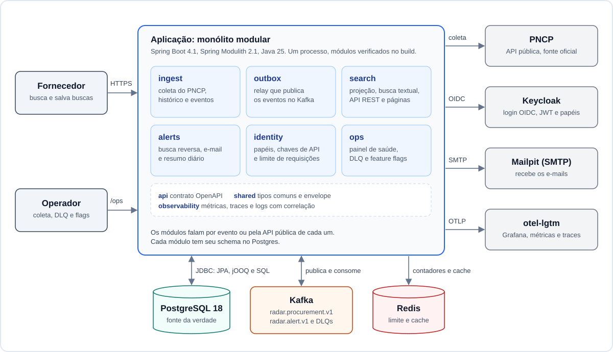
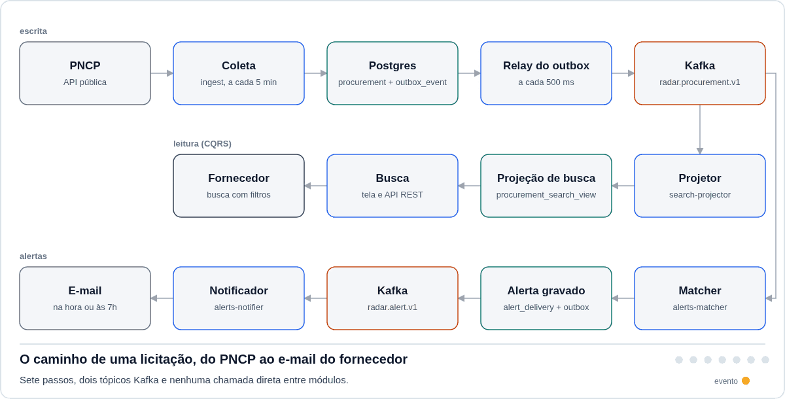
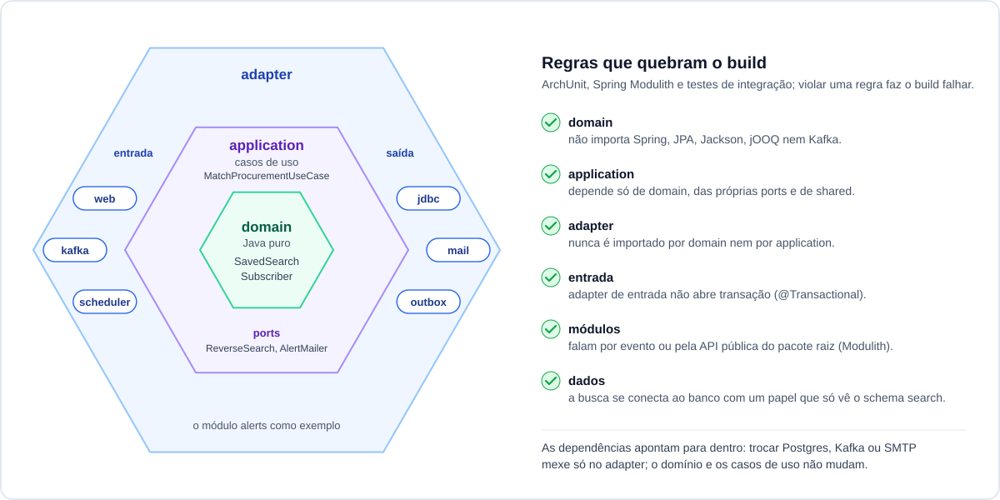
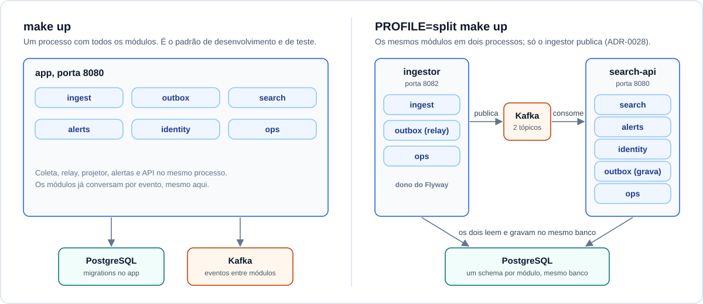

# Radar de Licitações

Coleta as licitações publicadas no PNCP (Portal Nacional de Contratações Públicas), guarda o histórico de cada uma, oferece busca textual em português e envia e-mail quando uma licitação nova atende a uma busca salva.


Java 25, Spring Boot 4.1 com Spring Modulith, PostgreSQL 18, Kafka 4.1, Redis 8, Keycloak 26 e OpenTelemetry. A pilha inteira sobe com `make up`, e a captura acima usa dados reais do PNCP.

O que foi medido aqui:

- `make chaos`: 10 mil eventos com falhas injetadas (latência e cortes de rede pelo Toxiproxy, Kafka e Postgres reiniciados no meio da carga). Nenhum evento perdido, e as 51 reentregas foram descartadas pelo inbox ([relatório](docs/benchmarks/chaos/2026-10-23.md)).
- `make bench`: busca textual no próprio Postgres com p95 de 83 ms, 50 usuários e 1,2 milhão de linhas, quase todas sintéticas ([Números](#números)).
- `make slo`: uma licitação atualizada no PNCP aparece na busca em 28 s, e o e-mail sai 0,9 s depois do casamento com a busca salva (os dois no p95, com tráfego sintético e coleta a cada 30 s; [SLOs medidos](#slos-medidos)).
- O build falha com cobertura de linha ou de ramo abaixo de 100% e quando um módulo atravessa a fronteira de outro.

## Arquitetura

Monólito modular com Spring Modulith: um processo, com módulos que só conversam por evento ou pela API pública de cada um. Dentro de cada módulo, arquitetura hexagonal; entre escrita e leitura, modelos separados (CQRS). O mesmo código roda em um processo ou em dois ([Um processo ou dois](#um-processo-ou-dois)).

### Visão geral



- **Quem usa.** O fornecedor busca licitações e salva buscas pela interface web ou pela API REST. O operador acompanha a coleta, a DLQ e os feature flags pelas rotas `/ops`.
- **O que roda.** Um processo com seis módulos de negócio (`ingest`, `outbox`, `search`, `alerts`, `identity`, `ops`) e três de apoio (`api`, `shared`, `observability`).
- **Onde ficam os dados.** O PostgreSQL é a fonte da verdade, com um schema por módulo. O Kafka leva os eventos de um módulo para outro. O Redis guarda os contadores do limite de requisições e o cache da página de detalhe.
- **Fora do processo.** O PNCP é a origem dos dados, o Keycloak faz o login, o Mailpit recebe os e-mails no ambiente local e o `otel-lgtm` (Grafana) mostra métricas, logs e traces.
- **Quem pode o quê.** Os `GET` de licitações, estatísticas e órgãos são públicos; a `X-Api-Key` só identifica o cliente no limite de requisições. Buscas salvas e chaves de API pedem um JWT do Keycloak com o papel `supplier`, e `/ops` pede o papel `operator` (`TOKEN=$(scripts/ops-token.sh)` no ambiente local; [ADR-0019](docs/adr/0019-seguranca.md)). O contrato está em [`radar-api.v1.yaml`](contracts/src/main/resources/openapi/radar-api.v1.yaml).

### O caminho de uma licitação



1. **Coleta.** A cada 5 min, contados do fim do ciclo anterior, o módulo `ingest` pede ao PNCP as licitações atualizadas, a 0,2 req/s, com novas tentativas, disjuntor e pausa quando o PNCP responde 429 ([ADR-0017](docs/adr/0017-resiliencia-cliente-pncp.md)). No compose, o PNCP é uma fixture local com um dia real versionado.
2. **Licitação e evento juntos.** O evento é gravado na tabela de outbox, na mesma transação da licitação. Se o processo cair, a transação inteira é desfeita, e a próxima execução relê o que não foi confirmado; o hash do conteúdo descarta o que já estava gravado ([ADR-0006](docs/adr/0006-coleta-incremental.md)).
3. **Relay.** A cada 500 ms o relay lê o outbox e publica em `radar.procurement.v1`. Uma trava no Postgres (advisory lock) deixa um só relay ativo, então os eventos de uma licitação saem na ordem em que foram gravados. Pode haver repetição, e o inbox descarta ([ADR-0018](docs/adr/0018-relay-do-outbox.md)).
4. **Projeção.** O consumidor `search-projector` anota o `event_id` de cada evento processado (inbox), ignora os repetidos e atualiza as tabelas de leitura do schema `search`. Como elas vêm só dos eventos, podem ser apagadas e reconstruídas relendo o tópico do início (`make replay`).
5. **Busca.** A tela e a API leem só a projeção, com jOOQ: full-text do Postgres ignorando acentos, índice GIN e paginação keyset ([ADR-0011](docs/adr/0011-busca-textual-postgres.md)).
6. **Busca reversa.** No mesmo tópico, o consumidor `alerts-matcher` compara a licitação com todas as buscas salvas numa única consulta SQL. A chave primária de `alerts.alert_delivery` impede dois alertas para o mesmo par (busca, licitação) ([ADR-0015](docs/adr/0015-matching-busca-reversa.md)).
7. **E-mail.** O alerta volta ao outbox e sai em `radar.alert.v1`. O consumidor `alerts-notifier` envia na hora ou junta no resumo diário das 7h. Mensagem com falha definitiva vai para a DLQ, e um operador pode reprocessá-la ([ADR-0026](docs/adr/0026-dlq-reprocessamento.md)).

Os passos 1 a 3 são a escrita, 4 e 5 a leitura e 6 e 7 os alertas. Em `radar.procurement.v1` saem `ProcurementDiscovered`, `ProcurementUpdated`, `ProcurementSituationChanged` e `ProcurementClosed`, com os esquemas em [`contracts/src/main/resources/events/`](contracts/src/main/resources/events/). Nenhum módulo chama outro diretamente.

<details>
<summary>Os termos acima, em uma linha cada</summary>

| Termo | O que é aqui |
| --- | --- |
| Outbox | Tabela `outbox.outbox_event`. O evento é gravado nela na mesma transação do dado e publicado no Kafka depois, pelo relay. |
| Relay | Tarefa agendada que lê o outbox em lotes de 100 (`FOR UPDATE SKIP LOCKED`), publica e marca como publicado. |
| Ao menos uma vez | Se o processo cair entre publicar e marcar, o lote sai de novo. Nenhum evento se perde, mas um evento pode sair repetido. |
| Inbox | Tabela `processed_event` de cada consumidor, com o `event_id` do que já foi aplicado. É ela que absorve as repetições. |
| Projeção | Tabela de leitura montada só a partir dos eventos, no formato que a busca precisa. |
| CQRS | Escrita e leitura com modelos separados: JPA no agregado de `ingest`, jOOQ nas projeções de `search`. |
| Keyset | A próxima página começa depois do último item visto, sem `OFFSET`; a API devolve esse ponto como um cursor opaco. |
| Busca reversa | Cada licitação nova é comparada com todas as buscas salvas numa consulta SQL. |
| DLQ | Tópico de mensagens com falha definitiva (`<tópico>.dlq`), gravadas em `ops.dlq_message` para reprocessar com `POST /ops/dlq/{topic}/reprocess`. |

</details>

### Por que cada peça existe

| Problema | Como o projeto resolve | Detalhes |
| --- | --- | --- |
| Gravar no banco e publicar no Kafka são duas operações, e uma pode falhar sem a outra. | Transactional Outbox: o evento é uma linha gravada na mesma transação, e um relay publica depois. | [ADR-0018](docs/adr/0018-relay-do-outbox.md) |
| O Kafka pode entregar o mesmo evento mais de uma vez. | Cada consumidor guarda o `event_id` numa tabela de inbox e ignora o que já processou. | [ADR-0026](docs/adr/0026-dlq-reprocessamento.md) |
| Eventos da mesma licitação não podem ser aplicados fora de ordem. | Um relay ativo por vez, em ordem de gravação, e o consumidor confere a versão do agregado. | [ADR-0018](docs/adr/0018-relay-do-outbox.md) |
| O PNCP limita a taxa, demora e às vezes sai do ar. | Resilience4j com limite de 0,2 req/s, novas tentativas com backoff e jitter, bulkhead, disjuntor e pausa no 429. | [ADR-0017](docs/adr/0017-resiliencia-cliente-pncp.md) |
| Busca rápida em português, sem outro cluster para operar. | Full-text do Postgres com a configuração `portuguese_unaccent`, índice GIN, pesos e keyset. p95 de 83 ms no cenário S1 (50 usuários) com 1,2 milhão de linhas, quase todas sintéticas. | [ADR-0011](docs/adr/0011-busca-textual-postgres.md) |
| Cada licitação nova precisa ser comparada com milhares de buscas salvas. | Busca reversa: uma consulta SQL por evento, 24 ms (p50, só a consulta) com 10 mil buscas ativas sintéticas. | [ADR-0015](docs/adr/0015-matching-busca-reversa.md) |
| Uma mensagem que nunca vai dar certo travaria a partição. | DLQ por tópico, registro no banco e reprocessamento sob demanda. | [ADR-0026](docs/adr/0026-dlq-reprocessamento.md) |
| A tabela de licitações cresce todo mês. | Partição por mês de publicação, criada com antecedência por uma tarefa diária e vigiada por alerta. | [ADR-0010](docs/adr/0010-jpa-escrita-jooq-leitura-particionamento.md) |
| O modelo bom para gravar não é o bom para buscar. | CQRS: JPA no agregado de escrita, jOOQ nas projeções de leitura. | [ADR-0010](docs/adr/0010-jpa-escrita-jooq-leitura-particionamento.md) |
| Um cliente sozinho pode esgotar a API. | Limite de requisições por balde de fichas no Redis, e cache da página de detalhe (81,5% de acerto no benchmark de [Números](#números)). | [ADR-0027](docs/adr/0027-redis-limite-e-cache.md) |

### Dentro de um módulo



Cada módulo separa `domain` (regras em Java puro), `application` (os casos de uso) e `adapter`. Ports são as interfaces que o caso de uso declara, como `AlertMailer`, e os adapters as implementam: os de entrada chamam o caso de uso (web, Kafka, `scheduler`) e os de saída são chamados por ele (JDBC, SMTP, outbox). As regras rodam como teste com ArchUnit e `ApplicationModules.verify()` do Spring Modulith, e o build falha se alguém quebrar uma fronteira ([ADR-0003](docs/adr/0003-monolito-modular-hexagonal.md)). Regras verificadas:

- `domain` não importa Spring, JPA, Jackson, jOOQ nem Kafka.
- `application` depende só de `domain`, das próprias ports e de `shared`.
- Nenhum adapter é importado por `domain` ou `application`, e adapter de entrada não abre transação.
- Um módulo fala com outro por evento ou pela API pública do pacote raiz.
- A busca se conecta ao banco com um papel que só vê o schema `search`.

O mapa de dependências gerado pelo Spring Modulith está em [`docs/modules/`](docs/modules/), e o modelo C4 em [`docs/diagrams/workspace.dsl`](docs/diagrams/workspace.dsl).

A cobertura de teste é requisito do build: 100% de linha e de ramo em cada módulo Maven (`core` e cada app), com unidade e integração (Testcontainers) somadas e exclusão só para código gerado ([ADR-0004](docs/adr/0004-gate-de-cobertura.md)).

### Um processo ou dois



`make up` sobe o monólito, o padrão de desenvolvimento e de teste. `PROFILE=split make up` sobe os mesmos módulos em dois apps de `apps/`, construídos sobre o mesmo `core`: o `ingestor` (coleta e relay, porta 8082) e a `search-api` (busca, alertas e identidade, porta 8080). O módulo `ops` vai nos dois. A coleta é limitada por I/O e roda agendada; a `search-api` gasta CPU, precisa de latência baixa e pode escalar na horizontal (o Helm ainda não tem a forma dividida). Os dois apps usam o mesmo Postgres e o mesmo Kafka. A `search-api` grava os alertas no outbox, mas só o relay do `ingestor` publica, e só o `ingestor` roda as migrations do Flyway. Os alertas ficam na `search-api` porque a busca reversa usa a mesma configuração de texto do schema `search` ([ADR-0028](docs/adr/0028-extracao-ingestor-e-search-api.md)).

### Mapa do repositório

```
apps/        ingestor e search-api, os dois apps da forma dividida
contracts/   OpenAPI da API v1 (openapi/) e esquemas dos eventos (events/ em JSON Schema, avro/)
core/        a aplicação: módulos, migrations do Flyway e testes
docs/        ADRs, benchmarks, runbook, post-mortem, diagramas e imagens
e2e/         fluxo ponta a ponta contra o compose
infra/       compose, Helm, Terraform, Keycloak, Grafana, Prometheus e Debezium
it-image/    teste de container da imagem Docker
perf/        cenários Gatling S1 a S6 da busca
scripts/     bench, slo, deploy, rollback e o restante dos alvos do Makefile
tools/       sonda do PNCP e gerador de massa sintética
```

### Decisões

São 28 ADRs em [`docs/adr/`](docs/adr/), cada uma com contexto, alternativas rejeitadas e consequências.

<details>
<summary>As 28 ADRs por tema</summary>

| Tema | ADRs |
| --- | --- |
| Fundação | [0001](docs/adr/0001-registro-de-decisoes.md) registro de decisões, [0002](docs/adr/0002-java-25-spring-boot-maven.md) Java 25 e Spring Boot 4.1, [0003](docs/adr/0003-monolito-modular-hexagonal.md) monólito modular e hexagonal, [0004](docs/adr/0004-gate-de-cobertura.md) gate de cobertura, [0009](docs/adr/0009-java-moderno-no-dominio.md) Java moderno no domínio |
| Coleta | [0005](docs/adr/0005-recorte-e-etiqueta-de-coleta.md) recorte, [0006](docs/adr/0006-coleta-incremental.md) coleta incremental, [0017](docs/adr/0017-resiliencia-cliente-pncp.md) resiliência do cliente PNCP, [0020](docs/adr/0020-concorrencia-na-coleta.md) concorrência na coleta |
| Dados e busca | [0010](docs/adr/0010-jpa-escrita-jooq-leitura-particionamento.md) JPA, jOOQ e partições, [0011](docs/adr/0011-busca-textual-postgres.md) busca textual no Postgres, [0014](docs/adr/0014-thymeleaf-htmx.md) Thymeleaf e htmx, [0027](docs/adr/0027-redis-limite-e-cache.md) Redis |
| Eventos | [0007](docs/adr/0007-eventos-json-schema-depois-avro.md) JSON Schema e depois Avro, [0008](docs/adr/0008-kafka-vs-rabbitmq.md) Kafka ou RabbitMQ, [0018](docs/adr/0018-relay-do-outbox.md) relay do outbox, [0024](docs/adr/0024-apicurio-avro-e-transicao-dual-format.md) Apicurio e Avro, [0026](docs/adr/0026-dlq-reprocessamento.md) DLQ e reprocessamento |
| Alertas | [0015](docs/adr/0015-matching-busca-reversa.md) busca reversa, [0016](docs/adr/0016-lgpd-assinantes.md) LGPD dos assinantes |
| Segurança e operação | [0019](docs/adr/0019-seguranca.md) Keycloak e papéis, [0021](docs/adr/0021-feature-flags-togglz.md) feature flags, [0025](docs/adr/0025-observabilidade-e-slos.md) observabilidade e SLOs |
| Entrega | [0012](docs/adr/0012-gatling-para-carga.md) Gatling, [0013](docs/adr/0013-contract-first-openapi.md) contract-first, [0022](docs/adr/0022-imagem-compose-deploy.md) imagem e deploy, [0023](docs/adr/0023-helm-kind-terraform-localstack.md) Helm e Terraform, [0028](docs/adr/0028-extracao-ingestor-e-search-api.md) extração em dois apps |

</details>

## Como rodar

Precisa de Docker (com o plugin `compose`) e de uns 4 GB de RAM livres para a pilha inteira (cerca de 2,8 GiB medidos, ver `docs/benchmarks/compose-memory.md`).

```
make up      # cria .env e segredos, constrói a imagem se faltar e sobe tudo saudável (cerca de 2 min)
make seed    # dispara em segundo plano o carregamento de 1 dia de dados reais do PNCP (cerca de 30 s)
make down    # para o ambiente (CLEAN=1 make down também apaga os volumes)
```

`make logs` acompanha os logs (`SERVICE=app` para um só). `PROFILE=layer3 make up` sobe também o Apicurio; com `make schemas-register` e `RADAR_MESSAGING_FORMAT=avro` os eventos passam a sair em Avro (ADR-0024, `docs/benchmarks/schema/evolution.md`). `PROFILE=cdc make up` troca o relay por polling pelo Debezium (ADR-0018, `docs/benchmarks/cdc/polling-vs-debezium.md`). `PROFILE=split make up` troca o monólito por dois serviços, `ingestor` (coleta e relay, porta 8082) e `search-api` (busca, alertas e identidade, porta 8080), com o `ops` nos dois, a partir de `make image-split` (ADR-0028); `make e2e-split` roda o fluxo ponta a ponta nessa forma. Nesse perfil a coleta é do ingestor: `RADAR_APP_URL=http://localhost:8082 make seed` (ou `make backfill`); ao trocar de perfil rode `make down` antes.

| O quê | URL | Acesso |
| --- | --- | --- |
| Aplicação | http://localhost:8080 | login pelo Keycloak: `fornecedor` / `fornecedor` (papel supplier) |
| Grafana (dashboards, traces) | http://localhost:3000 | `admin` / `admin` |
| Mailpit (e-mails) | http://localhost:8025 | sem login |
| Keycloak | http://localhost:8180 | console: `admin` / `troque-me` (`infra/compose/.env`); usuário `operador` / `operador` (papel operator) |

Os dados do seed são públicos, do PNCP, coletados em 2026-10-22 (editais da modalidade 6 publicados em 2026-10-21, 1.633 linhas); o compose não acessa o PNCP real. Todos os valores acima são padrões de desenvolvimento, só para uso local.

Outros alvos: `make verify` (build completo: exige JDK 25 e Docker, porque os testes de integração sobem containers com Testcontainers e o build gera o modelo jOOQ a partir das migrations num Postgres descartável) e `make e2e` (sobe o compose e roda o fluxo ponta a ponta; exige as portas livres e a imagem, `make image`).

O resultado de `make bench` alimenta a seção Números e `docs/benchmarks/search/`; `make docs-check` confere que o bloco de números é o que `docs/benchmarks/latest.json` gera. O commit citado em cada medição é o commit do PR na `main` (`BENCH_COMMIT`, ver `scripts/render-metrics.sh`).

Imagem do monólito: 617 MB (medido por `scripts/image-size.sh` em 2026-10-24, sobre a imagem construída em 2026-10-23, depois do PR 6.2, com o G1 fixado). A medição anterior, 393 MB em 2026-10-22, era do M0 e não tem a busca, os alertas, o Redis nem o Avro.

### Reproduzir as medições

Cada alvo gera o artefato versionado ao lado do relatório. Com exceção de `make chaos` (Testcontainers) e `make replay` (usa a pilha já no ar), todos pedem a imagem (`make image`, ou `make image-split` para o perfil dividido). Rode um por vez, sem outra pilha nas portas fixas.

| Alvo | O que faz | Relatório |
| --- | --- | --- |
| `make bench` | busca com 1,2 milhão de linhas (dia real mais massa sintética), planos sem e com índices, Gatling S1 a S6 (cerca de 1 h, uns 6 GB livres) | `docs/benchmarks/search/` |
| `make bench-pool` | repete S1, S2 e S5 com o pool de busca em 10, 20 e 40 conexões | `docs/benchmarks/db/hikari.md` |
| `make slo` | SLOs com tráfego misto sintético sobre 200 mil linhas (15 min por padrão; `SLO_DURATION=1h` para o plano) | `docs/benchmarks/slo/` |
| `make profile GC=serial\|g1\|zgc\|all` | a mesma carga sob cada coletor de lixo, com JFR | `docs/benchmarks/jvm/` |
| `make replay` | com a pilha no ar, reconstrói o read model do offset 0 do tópico e imprime o relatório | `docs/benchmarks/replay/` |
| `make chaos` | 10 mil eventos com Toxiproxy; as perdas e as duplicatas impressas no fim devem ser 0 | `docs/benchmarks/chaos/` |
| `make deploy TAG=<tag>` e `make rollback` | troca a imagem do `app` com smoke e volta ao deploy anterior (ADR-0022) | `docs/runbook.md`, seção Rollback |
| `make e2e-split` | o fluxo ponta a ponta com `ingestor` e `search-api` (depois de `make image-split`) | ADR-0028 |

### Sonda do PNCP (histórico)

A sonda (`tools/pncp-probe`) rodou em 2026-10-22, das 17:02 às 19:44, em três execuções, a 0,5 req/s com `User-Agent` próprio. A API pública respondeu 429 a essa taxa e a sonda parou ali, como estava previsto: 2.646 requisições, sem as 24 h, sem a rampa de taxa e sem a madrugada. Ela não foi retomada. O que se mediu decidiu o recorte (ADR-0005), a estratégia incremental (ADR-0006) e a taxa de coleta, 0,2 req/s ([ADR-0017](docs/adr/0017-resiliencia-cliente-pncp.md)). O relatório está em [`docs/benchmarks/probe/2026-10-22.md`](docs/benchmarks/probe/2026-10-22.md).

`make probe` continua no repositório como evidência e agora exige `PROBE_CONFIRM=1`, porque rodá-la de novo volta a pressionar a API real. `make probe-report` gera o relatório a partir do JSONL gravado (`tools/pncp-probe/out`, fora do git).

## Interface

Busca em `/` (texto, UF, modalidade e "somente com propostas abertas"), detalhe em `/licitacoes/{id}` com o histórico de situação e o link para o edital no PNCP. As páginas são renderizadas no servidor com Thymeleaf e atualizadas com htmx servido pela própria aplicação (ADR-0014).

A captura do topo mostra dados reais do PNCP, os editais da modalidade 6 publicados em 2026-10-21 (o dia versionado em `infra/compose/seed`, coletado em 2026-10-22). `make readme-gif` roda o teste de captura e a regera (precisa do ImageMagick).

`make e2e-ui` roda o teste da interface num Chromium (Playwright) contra a aplicação em processo com Postgres de teste; baixa o navegador na primeira vez e `PLAYWRIGHT_SKIP=1` pula o teste.

## Observabilidade

- Métricas: `GET /actuator/prometheus` (exige o papel `operator`). No compose a aplicação envia as métricas por OTLP ao `otel-lgtm`; os nomes usados nos dashboards e nas regras, e como chegam por OTLP, estão no ADR-0025.
- Traces: OpenTelemetry com envio OTLP para `OTEL_EXPORTER_OTLP_ENDPOINT` (padrão `http://localhost:4318`). Sem coletor o exportador registra avisos; para desligar só o envio, `MANAGEMENT_TRACING_EXPORT_OTLP_ENABLED=false`. O trace de uma requisição HTTP continua pelo outbox e pelo registro Kafka (header `traceparent`). No compose, o Grafana do `otel-lgtm` (porta 3000) mostra os traces e os dashboards de `infra/grafana`.
- Operação: `docs/runbook.md` tem uma seção por alerta (sintoma, impacto, diagnóstico, ação, escalonamento) e as operações rotineiras; o incidente simulado de partição ausente está em `docs/post-mortem/`.
- Logs: texto no desenvolvimento; JSON na imagem (perfil `json`), com `traceId`, `spanId` e `correlationId`. O cabeçalho `X-Correlation-Id` é aceito na entrada e devolvido na resposta.

## Números

<!-- bench:start -->
Medido em 2026-10-23 (commit `2ce350f`), AMD Ryzen 5 5600GT with Radeon Graphics, 12 threads, 11,6 GiB de RAM, Postgres 18.6, 1.200.000 linhas de busca: 1.633 reais do PNCP (dia versionado em `infra/compose/seed`) e 1.198.367 sintéticas. Rótulo de todo número abaixo: **inclui dados sintéticos (1.198.367 linhas)**. Uma execução por cenário, 1 min de aquecimento descartado e 3 min medidos; cada usuário espera 1 s entre requisições.

| Cenário | Usuários | Requisições | Erros | p50 (ms) | p95 (ms) | p99 (ms) | req/s |
| --- | ---: | ---: | ---: | ---: | ---: | ---: | ---: |
| S1 text search | 50 | 8.662 | 0 | 34 | 83 | 122 | 48,1 |
| S2 filtered search | 50 | 8.925 | 0 | 6 | 22 | 46 | 49,6 |
| S3 keyset p1 (medido em 2026-10-23, commit `1496441`) | 10 | 300 | 0 | 2 | 3 | 5 | 1,7 |
| S3 offset p1 (medido em 2026-10-23, commit `1496441`) | 10 | 300 | 0 | 2 | 4 | 6 | 1,7 |
| S3 keyset p100 (medido em 2026-10-23, commit `1496441`) | 10 | 300 | 0 | 2 | 3 | 6 | 1,7 |
| S3 offset p100 (medido em 2026-10-23, commit `1496441`) | 10 | 300 | 0 | 5 | 7 | 8 | 1,7 |
| S3 keyset p1000 (medido em 2026-10-23, commit `1496441`) | 10 | 300 | 0 | 2 | 3 | 7 | 1,7 |
| S3 offset p1000 (medido em 2026-10-23, commit `1496441`) | 10 | 300 | 0 | 31 | 38 | 48 | 1,7 |
| S4 organ typo | 20 | 3.545 | 0 | 13 | 18 | 23 | 19,7 |
| S5 detail | 100 | 17.975 | 0 | 1 | 2 | 5 | 99,9 |
| S6 stats by uf (medido em 2026-10-23, commit `1496441`) | 10 | 900 | 0 | 2 | 2 | 3 | 5 |
| S6 stats by month (medido em 2026-10-23, commit `1496441`) | 10 | 900 | 0 | 2 | 2 | 3 | 5 |

- Cache do detalhe (S5): 19.518 acertos e 4.444 faltas, taxa de acerto de 81,5%.
- SLO de busca (S1 e S2, p95 até 200 ms e p99 até 500 ms): S1 atende, S2 atende.
- SLO de detalhe (S5, p95 até 50 ms): atende.
- Planos, hardware e leitura completa: `docs/benchmarks/search/2026-10-23-pr63/README.md`.
<!-- bench:end -->

### SLOs medidos

<!-- slo:start -->
Medido em 2026-10-23 (commit `441ba19`), AMD Ryzen 5 5600GT with Radeon Graphics, 12 threads, 11,6 GiB de RAM, Postgres 18.6, 200.000 linhas de busca: 1.633 reais do PNCP e 198.367 sintéticas, mais 1.370 editais do PNCP simulado coletados durante a medição. Rótulo de todo número abaixo: **sintético** (massa e tráfego de ingestão). Janela medida de 15 min, depois de 60 s de aquecimento descartado; coleta incremental a cada 30 s (o padrão da aplicação é 5 min); carga mista S1, S2, S5 e S6 com 5, 5, 10 e 2 usuários.

| SLO | Alvo | Medido | Atende |
| --- | --- | ---: | --- |
| Frescor interno: coleta até a projeção | p95 até 30 s | 1,41 s | sim |
| Frescor ponta a ponta: dataAtualizacaoGlobal até visível na busca | p95 até o intervalo de polling mais 1 min (90 s com polling de 30 s) | 28,17 s | sim |
| Alerta: match até o SMTP aceitar | p95 até 60 s | 0,92 s | sim |
| Busca S1 text search: p95 | p95 até 200 ms | 18 ms | sim |
| Busca S1 text search: p99 | p99 até 500 ms | 86 ms | sim |
| Busca S2 filtered search: p95 | p95 até 200 ms | 6 ms | sim |
| Busca S2 filtered search: p99 | p99 até 500 ms | 18 ms | sim |
| Detalhe S5 com cache: p95 | p95 até 50 ms | 3 ms | sim |
| Outbox: idade da mensagem mais antiga, p99 | p99 até 5 s | 0,00 s | sim |
| Disponibilidade da API durante caos com Toxiproxy | 99,5% em 1 h | não medido | não medido |
| Disponibilidade da busca sem caos (informativo) | sem alvo próprio (o alvo do plano vale com caos) | 100,000 % | sem alvo |
| Busca vista pelo servidor: p95 (informativo) | sem alvo próprio | 14,8 ms | sem alvo |
| Estatísticas S6: p95 (informativo) | sem alvo no plano | 2 ms | sem alvo |

- Leitura completa e limites: `docs/benchmarks/slo/2026-10-23.md`.
<!-- slo:end -->

A latência de S1 e S2 da tabela acima vem de `make slo`, com 200 mil linhas de busca; por isso é bem menor que a da seção Números, que vem de `make bench` com 1,2 milhão de linhas (S1: p95 de 83 ms contra 18 ms). O SLO de busca (p95 até 200 ms) vale nos dois volumes; o número de referência para o volume cheio é o do `make bench`.

## Estado

Os marcos M0 a M8 estão entregues e o M9 (camada 4) não foi feito. Cada capacidade tem código, teste ou benchmark e ADR; os números vêm de `make bench` e `make slo`, com data, hardware e rótulo real ou sintético.

- M0: sonda do PNCP e fundação do repositório.
- M1: coleta incremental e backfill, outbox transacional, Kafka e projeção.
- M2: busca textual em português, API REST e interface Thymeleaf com htmx, benchmark com 1,2 milhão de linhas.
- M3: alertas por e-mail para buscas salvas e resumo diário.
- M4: observabilidade, SLOs, caos com Toxiproxy, painel de operação e DLQ.
- M5: segurança (OIDC, papéis, chaves de API, checklist OWASP) e Redis (limite de requisições e cache do detalhe).
- M6: virtual threads na coleta, escolha do coletor de lixo e otimização guiada por profile.
- M7: imagem, compose como ambiente oficial, deploy com rollback, Helm e Terraform.
- M8: Avro com Apicurio, extração em `ingestor` e `search-api`, Debezium como alternativa ao relay e mensageria avançada (rebalance, backpressure, ordem).

O que foi cortado, e por quê, está nas notas de escopo da [ADR-0001](docs/adr/0001-registro-de-decisoes.md). Em resumo:

- M9 (gRPC ou GraphQL): não feito.
- Spring Cloud Contract: adiado, sem linha compatível com o Boot 4.1; o contrato OpenAPI é verificado por teste.
- Sem `release.yml` (não há GitHub Release com jar, SBOM e checksums) e sem OpenAPI no GitHub Pages.
- Disponibilidade da API sob caos: não medida no compose; o caos prova perda e duplicata zero em teste.
- A sonda do PNCP terminou no 429, sem as 24 h, sem a rampa de taxa e sem a madrugada.
- Sem JMH: o ponto quente era SQL, não código da JVM.
- O Helm não tem a forma dividida e recusa mais de uma réplica; o nightly é só a fumaça da busca (sem PIT completo, sem backfill real de 1 dia, sem dependency-check).
- Sem captura de tela de trace e sem snapshot do PNCP como asset de release; badges não se aplicam, porque o repositório é local.

## Fora do escopo

- Nuvem permanente.
- Provedor de e-mail externo.
- MFA e WebAuthn.
- Contratos, atas e itens: a sonda não deu base para liberar (`niFornecedor` pode ser CPF, `atas` com timeout; ver `docs/benchmarks/probe/2026-10-22.md`, S6).
- gRPC e GraphQL (camada 4, M9): não feito.

## Licença

Distribuído sob a licença MIT. Veja o arquivo [LICENSE](LICENSE).
